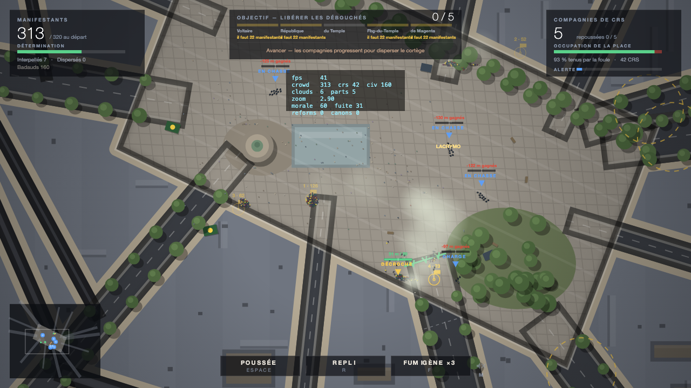

# RÉPUBLIQUE

Jeu de foule en vue de dessus sur la place de la République et les rues
alentour, reconstruites d'après la vue satellite (`reference.png`).
Vous dirigez un cortège de manifestants ; en face, des compagnies de CRS
tiennent les débouchés de la place. Objectif : les repousser hors de la place.

Canvas 2D, JavaScript vanilla, aucune dépendance, aucun build.



## Lancer

Double-cliquer `index.html`, ou servir le dossier :

```sh
python3 -m http.server 8766
# http://127.0.0.1:8766/index.html
```

L'écran d'accueil règle **le nombre de manifestants au départ** (40 à 5000) et
la **pression policière**, exprimée en ratio : modérée (1 CRS pour 9
manifestants), tendue (1 pour 6) ou nasse (1 pour 4). L'effectif déployé est
donc **proportionnel au cortège**, et l'écran affiche le calcul en direct
(« 30 CRS · 3 compagnies de 10 »).

| Cortège | Modérée | Tendue | Nasse |
|---|---|---|---|
| 180 | 20 CRS (2×10) | 30 (3×10) | 44 (4×11) |
| 600 | 66 (6×11) | 99 (9×11) | 150 (10×15) |
| 1500 | 167 (10×17) | 250 (10×25) | 375 (10×38) |
| 5000 | 460 (10×46) | 460 (10×46) | 460 (10×46) |

L'effectif total est borné entre 8 et 460 hommes, répartis en 2 à 10 compagnies
— c'est aussi le nombre de débouchés à libérer. Une compagnie large se range
sur plusieurs rangs (12 hommes de front au maximum) au lieu d'étirer une ligne
plus large que la rue.

### Densité et coût

La foule est **plafonnée à 5 personnes au mètre carré** (`MAX_DENSITY`). La
résolution par paires n'y suffit pas quand des dizaines de corps se superposent
— le balayage par cellules en rate la plupart — donc une passe de détassement
relâche chaque cellule surchargée, deux fois par image, en coût constant par
agent. Mesuré : un empilement artificiel de 800 personnes sur 4 m² retombe à
4 pers/m² en une seconde et 2,5 au bout de dix ; en partie réelle les pics de
bousculade plafonnent à 6.

| Manifestants | + badauds | + CRS | ms/image (CPU) |
|---|---|---|---|
| 180 | 90 | 30 | 2,6 |
| 600 | 298 | 99 | 8,5 |
| 1200 | 597 | 200 | 17,3 |
| 2000 | 998 | 330 | 20,1 |
| 3000 | 1490 | 460 | 32,2 |
| 5000 | 2488 | 460 | 50,3 |

Au-delà de 1200 manifestants, la foule et la mêlée sont mises à jour par
moitiés alternées (pas de temps doublé), les badauds une image sur deux, et la
pression sur chaque ligne est échantillonnée au quart. Le confort s'arrête
autour de 2000 ; 5000 tourne mais à une vingtaine d'images par seconde côté
calcul, avant même le rendu.

## Commandes

| Entrée | Effet |
|---|---|
| Clic gauche | Pose une cible (2 maximum) ou saisit la plus proche ; maintenir pour la traîner |
| Maj + clic | Force une nouvelle cible |
| `X` | Supprime la cible active |
| `Espace` | **Poussée** — le cortège charge la ligne de boucliers |
| `R` | **Repli** — rompre le contact, la détermination remonte vite |
| `F` | **Fumigène** (×3) — abrite la foule et fait rater les tirs de lacrymo |
| Molette | Zoom |
| Clic droit glissé | Déplacer la caméra · `C` recentre |
| `F3` | Overlay de debug · `Échap` pause |

## Scinder le cortège

**Deux cibles simultanées** (constante `MAX_TARGETS` dans `js/util.js`). En
posant la seconde, **25 % du cortège — les manifestants les plus proches
d'elle — s'en détachent** et la rejoignent : le cortège se divise en deux
colonnes qui avancent chacune vers son objectif. Chaque groupe a son propre champ de navigation et sa propre
régulation d'allure, et chaque cible affiche son numéro et son effectif.
Supprimer une cible renvoie son groupe vers la plus proche.

C'est la réponse aux compagnies mobiles : une colonne unique se fait
intercepter, deux colonnes obligent la police à se diviser.

## Trouver les CRS

Au départ les compagnies tiennent les débouchés de la place, à 140-240 m du
cortège : elles sont **hors de l'écran**. Trois repères pour les situer —
un chevron bleu épinglé au bord de l'écran avec le nom de la rue et la
distance, un chevron au-dessus de chaque ligne une fois à l'écran (jaune
quand elle décroche), et les points bleus de la minicarte. Le message
d'ouverture énumère les rues tenues.

## La boucle : libérer les débouchés

L'objectif est affiché en haut de l'écran : **libérer les débouchés** que les
compagnies tiennent. Pour chacun :

1. **Battre la compagnie.** Chaque ligne a une *ligne de tenue* tracée au sol et
   un *repère de rupture* 20 m derrière elle, dans la rue. La ligne recule
   physiquement sous la pression du cortège ; **passée son repère, la compagnie
   décroche**. Rien d'autre : plus de seuil caché, on lit la victoire en mètres.
   Une jauge au-dessus de chaque ligne montre le rapport de force (foule à
   gauche du trait, CRS à droite) et le compteur `+12 m / 20`.
2. **Tenir le débouché.** Une fois la rue dégarnie, rassemblez-y du monde
   (environ 7 % du cortège) pendant 7 s : un anneau de capture se remplit.
3. **Les renforts arrivent** par la rue libérée (+25 % du cortège de départ),
   ce qui donne de quoi attaquer la suivante.

**Victoire** : tous les débouchés libérés. **Défaite** : moins de 22 % du
cortège, détermination au plancher, ou la place balayée (occupation sous 25 %
pendant 20 s).

Une compagnie partie balayer la place **laisse sa rue dégarnie** : on peut la
capturer dans son dos au lieu de l'affronter de face.

## Pas de spirale de la mort

Une compagnie qui commence à perdre ne continue pas mécaniquement à perdre
jusqu'à disparaître. Trois mécanismes l'en empêchent :

- **Décrochage borné.** Une ligne qui cède recule de **42 m**, puis s'arrête et
  **se regroupe** sur place (intention « SE REGROUPE ») au lieu de disparaître
  au fond de la rue. Si elle ne peut plus revenir (trois reformations déjà
  utilisées, rue libérée, moins de trois hommes), elle décroche pour de bon,
  plafonné à 95 m, et s'efface. Il faut avoir décroché **12 s** avant de
  pouvoir se reformer, sinon une compagnie cassée se reformait dans la seconde.
- **Récupération.** Dès que plus personne ne pousse (pression < 0,6 pendant
  2 s), l'endurance des hommes remonte — 4,5 pts/s en ligne, 7 pts/s pour une
  compagnie qui a décroché. Et une compagnie laissée tranquille **25 secondes**,
  avec au moins 3 hommes et 45 d'endurance moyenne, **se reforme et revient**
  (trois fois au maximum, et jamais si sa rue a déjà été libérée pour de bon).
  Elle réinstalle alors sa ligne de tenue là où elle s'est regroupée.
  D'où l'urgence : après avoir cassé une ligne, il faut aller tenir la rue tout
  de suite, pas flâner.
- **Renfort lourd.** Une fois la première rue perdue, un **canon à eau** remonte
  une rue encore tenue, repousse la foule au jet dans un cône de 36 m, vide la
  détermination et trempe les gens (ils courent moins vite). **Un second canon
  arrive ensuite par le côté opposé de la place** : ils encadrent le cortège.
  Chacun encaisse les projectiles et se replie à 120 points de dégâts. Un
  marqueur dédié annonce leur arrivée et leur distance.
- **Rendements décroissants.** Entasser plus de monde au même endroit ne paie pas
  proportionnellement : au-delà de la *frontage* de la ligne
  (`1,7 × hommes debout + 3`), la pression supplémentaire ne compte plus que de
  façon logarithmique. Deux fois plus de manifestants au contact ne donnent que
  +69 % de pression — mieux vaut ouvrir un second front que tout empiler.
- **Incertitude limitée.** La force de chaque compagnie oscille lentement de
  ±5 % (bruit filtré, renouvelé toutes les 1,5 à 3 s) : assez pour des
  retournements, trop peu pour rendre vos décisions indifférentes.

## Ce que font les CRS

Ils n'attendent pas d'être attaqués, et ils ne se contentent pas d'avancer en
ligne droite : **sans contact, chaque compagnie prend en chasse un cortège**
(`EN CHASSE`), à 2,2 m/s plus l'alerte, en se répartissant sur les différents
groupes — les compagnies ne convergent pas toutes sur le même. Elles ne
s'arrêtent qu'au contact. Dès la première seconde, elles **avancent** pour
disperser et interpeller. Lentement au début (0,55 m/s), puis
de plus en plus vite à mesure que l'**alerte** monte — une jauge partagée par
toute l'opération, affichée dans le panneau de droite. Elle grimpe dès qu'une
ligne est au contact, et à chaque homme blessé ou touché par un projectile :
taper une compagnie fait accélérer toutes les autres. Au maximum l'avance
atteint 1,85 m/s. Elles s'enfoncent jusqu'à 62 m dans la place (110 m en phase
Disperser) puis tiennent le terrain gagné.

L'opération escalade, et chaque ligne affiche son intention
(AVANCE, TIENT, RECULE, CHARGE, BALAIE, NASSE, DÉCROCHE) :

| Phase | Déclencheur | Ce qu'ils font |
|---|---|---|
| **Avancer** | début | Les compagnies progressent depuis leur débouché pour disperser le cortège. |
| **Disperser** | ~2 min 20, ou dès le premier débouché libéré | La moitié des compagnies **balaie l'esplanade**, lacrymo devant elles. |
| **Nasser** | ~5 min 20, ou cortège sous 60 % | Deux compagnies manœuvrent sur les flancs pour **encercler** une partie du cortège. |

### Au contact, ils ont l'avantage

- **Vitesses** : 4,2 m/s en ligne, **6,8 m/s en charge** — plus rapide qu'un
  manifestant qui court (5,1 m/s), donc une sortie d'interpellation rattrape sa
  cible. Avance de compagnie : 1,35 m/s au repos, **jusqu'à 3,75 m/s** quand
  l'alerte est au maximum. Tout le monde se déplace 50 % plus vite que dans les
  premières versions : la manifestation se joue au rythme de la rue
  (marche 2,25 m/s, course 5,1 m/s).
- **Masse** : un homme en ligne, bouclier calé, pèse **4,6** contre 1 pour un
  manifestant (2,1 en poussée) — il faut plus de quatre personnes déterminées
  pour le faire reculer d'un pas. Une ligne de dix compte pour 46.
- **Choc d'une charge** : chaque contact repousse le manifestant de 45 cm, le
  **sonne 0,45 s** (il ne peut plus pousser ni fuir) et lui coûte 1,4 point de
  détermination par image de contact. Une charge ouvre un trou dans la foule et
  laisse des gens isolés — ceux-là se font interpeller.
- **Usure** : pousser un bouclier coûte désormais moins cher aux CRS
  (0,06 pt/contact contre 0,085 avant) et leur force de ligne passe de
  `0,9 × hommes` à `1,15 × hommes`.

La préfecture s'impatiente aussi : l'alerte gagne un plancher qui monte seul
avec le temps (jusqu'à +0,35 après sept minutes), donc les compagnies
accélèrent même si vous évitez le contact.

Comme une compagnie peut désormais traverser la place, **la rupture se mesure
depuis son point le plus avancé** : il faut la repousser de 20 m à partir de
là, pas depuis sa rue d'origine — sinon une ligne qui a conquis du terrain
serait increvable.

Conséquence tactique : laisser filer le temps coûte du terrain. Le compteur
`−40 m / 20` d'une ligne indique qu'elle a gagné 40 m sur vous et qu'il faudra
l'en chasser avant de pouvoir la casser.

## Comment ça se joue

**La foule** suit un champ de flux calculé vers le curseur, en restant groupée :
cohésion locale, séparation, et régulation d'allure (ceux qui prennent de
l'avance ralentissent, les traînards accélèrent). Chaque manifestant a une
**détermination** : elle monte avec le nombre de voisins et sous un fumigène,
elle descend face aux boucliers, sous les gaz et à chaque interpellation
proche. En dessous de 14, il décroche et part par une rue ; au-delà de 150 m
de la place il est compté comme dispersé.

**Repousser** n'est pas scripté : les corps ne peuvent pas se superposer, donc
une masse dense pousse physiquement la ligne. Chaque bousculade entame
l'endurance des CRS. Quand la pression dépasse durablement la force de la
compagnie — ou quand trop d'hommes sont hors de combat — **la ligne cède** et
la compagnie décroche par une rue. La poussée (`Espace`) double le poids de
chaque manifestant mais use la détermination.

**Les interpellations** sont plafonnées à **trois escortes simultanées par
compagnie** : une charge peut saisir plusieurs personnes, mais pas vider le
cortège d'un coup. Sans ce plafond, six compagnies interpellaient 307
manifestants sur 400 en douze minutes.

**Des poubelles brûlent** sur l'esplanade — huit foyers dispersés, d'**un
rayon de 0,75 à 3,4 m** (beaucoup de petits bacs, quelques gros brasiers :
tirage en carré). Flammes à trois couches qui vacillent, halo chaud, cercle de
cendres et panache de fumée qui dérive avec le vent au-dessus de la mêlée ;
tout est à l'échelle du foyer. Manifestants, badauds et CRS les contournent.

**Les pompiers passent** : toutes les 70 à 130 secondes, un camion remonte la
rue la plus proche du **plus gros foyer**, se gare à 9 m, l'arrose jusqu'à
l'extinction (3 à 5 s selon la taille), puis repart par où il est venu.
Il **roule comme un véhicule** : il tourne le volant (1,9 à 3 rad/s selon
l'allure) puis avance dans l'axe de sa caisse, jamais en crabe ; vitesse de
croisière **21 m/s** (75 km/h), 24 m/s au retour, ralentissement progressif
sous 45 m à l'approche du feu. Son cap vise la route, pas le foyer — il ne se tourne vers les flammes
qu'une fois à l'arrêt, pour orienter la lance.

Son **itinéraire est explicite**, pas un suivi de champ de navigation :
l'**axe de la rue** jusqu'au débouché, puis une **courbe de Bézier quadratique**
vers le foyer dont le point de contrôle penche vers le **centre de la place**
(d'autant plus que le trajet est long). Chaque point de l'itinéraire est
ramené en zone praticable s'il tombe dans un immeuble, et le camion le suit en
poursuite pure. Mesuré : 1,9 m d'écart maximal à l'axe de la rue pour une
chaussée de 26 m, et un bombement de 23 m vers le centre sur la traversée de
l'esplanade. Un
nouveau foyer se rallume ailleurs 12 à 35 s plus tard, donc la place ne
s'éteint jamais complètement. Le camion suit un champ de navigation dédié,
calculé vers le feu au moment où il entre.

**Les badauds** — la moitié de l'effectif du cortège — ne manifestent pas : ils
viennent voir. Ils flânent sur l'esplanade, se placent à 26-48 m du cortège pour
regarder (certains filment), **s'écartent quand la manif avance** et quand un
CRS approche, détalent au premier gaz ou coup de canon à eau, et quittent la
place s'ils paniquent trop. Ils ne comptent ni dans la pression sur les lignes
ni dans la capture d'un débouché, mais ils encombrent le terrain, et une charge
qui leur passe dessus les éparpille. Compteur « Badauds » dans le panneau de
gauche.

**Les projectiles** partent par **salves** : chaque manifestant ne lance qu'une
fois toutes les 13 à 27 secondes, il faut une détermination supérieure à 68, et
un plafond global (4 jets par seconde, réserve de 8) empêche la pluie continue.
En échange chaque jet fait mal : 16 à 30 points d'endurance.

**Les CRS** tiennent une ligne sur deux rangs, reprennent du terrain quand la
pression retombe, lancent des **grenades lacrymogènes** sur le point le plus
dense à moins de 60 m, et font des **sorties d'interpellation** : deux ou trois
hommes sortent du rang, attrapent un manifestant isolé ou déjà ébranlé et le
ramènent derrière la ligne. Les projectiles lancés depuis la foule entament
leur endurance et les font tituber.

**Le gaz** dérive avec le vent, vide la détermination très vite et fait fuir.
Un fumigène posé entre la ligne et la foule gêne les tirs (la portée de visée
est dégradée tant que la fumée coupe la ligne de tir).

## Son

L'ambiance de la manifestation (`fond.mp3`, 5 min) tourne **en boucle** pendant
toute la partie. Le module cherche d'abord `bruits/fond.mp3` puis retombe sur
`fond.mp3` à la racine, donc le fichier peut être à l'un ou l'autre endroit.

Le volume suit l'action : base à 0,42, et il monte avec l'alerte policière, la
pression sur les lignes, les nuages de gaz et la présence d'un canon à eau
(plafond à 1,0). Il redescend à 0,30 sur l'écran de fin et se coupe en pause.
Touche **M** pour couper, indicateur à droite des boutons d'ordre.

Le son est un élément `<audio>` et non WebAudio : ça marche aussi en `file://`,
sans serveur. Si le navigateur refuse la lecture automatique, elle démarre au
premier clic ou à la première touche.

**Tirs de grenade** : chaque départ de lacrymogène **secoue brièvement la
caméra** (0,34 s, oscillation amortie d'environ 1,2 m d'amplitude) et joue un
des six sons de
`bruits/grenades/`, **tiré au hasard** (jamais deux fois le même d'affilée),
avec une légère variation de hauteur (±8 %). Les tirs se **superposent** —
plusieurs grenades, plusieurs détonations — dans la limite de sept sons
simultanés. Le volume dépend de la distance au centre de l'écran : plein à
moins de 55 m, quasi nul au-delà de 290 m — même atténuation pour la secousse,
qui est nulle au-delà de 235 m. La touche M coupe aussi les tirs.

## Paramètres d'URL (tests, captures, démo)

`?auto=1` démarre sans le menu. Options : `&nb=300` (manifestants),
`&ratio=0.167` (CRS par manifestant), `&warm=60` (pré-simule 60 s), `&zoom=6`, `&debug=1`,
`&demo=1` (la foule se dirige toute seule vers la compagnie la plus proche —
pratique pour regarder tourner le moteur).

Exemple : `index.html?auto=1&demo=1&nb=300&ratio=0.167&warm=70&zoom=6&debug=1`

## Structure

```
index.html      écran d'accueil (réglages de départ) + chargement des scripts
js/util.js      maths, RNG, polygones, index spatial, entrées souris/clavier
js/sound.js     ambiance sonore en boucle, volume piloté par l'intensité
js/map.js       géométrie de la place, percées, ruelles, grille de navigation,
                champs de flux (Dijkstra à seaux), rendu de la ville
js/crowd.js     manifestants (flux, cohésion, allure, détermination, fuite)
                et badauds (flânerie, curiosité, évitement, panique)
js/police.js    CRS : ligne, pression, charges, interpellations, lacrymo, repli
js/fx.js        nuages de gaz et de fumée, grenades, projectiles, cris
js/hud.js       compteurs, jauges, minicarte, ordres, écrans de fin
js/game.js      boucle, caméra, ordres, mêlée (collisions), victoire/défaite
```

Réglages utiles : `PLAZA` / `STREETS` (map.js) pour la géométrie,
`WALK` / `RUN` et le bloc morale (crowd.js), les seuils de `Squad.update`
et les cadences `gasCd` / `chargeCd` (police.js), la force de bousculade dans
`melee()` (game.js).

## Pistes suivantes

- Verbes de foule : barricade sur un débouché libéré, scinder le cortège en
  deux groupes, camion sono qui remonte la détermination.
- Canon à eau et nasse mobile (encerclement qui se referme vraiment).
- Journalistes et street medics : protéger une poignée d'unités fragiles.
- Objectifs scénarisés (tenir X minutes, rejoindre Nation) et score sauvegardé.

> Jeu de fiction. La place est reconstruite librement d'après une vue
> satellite ; les mécaniques sont des abstractions de jeu, pas une
> documentation de pratiques réelles.
